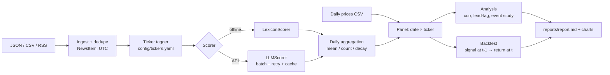
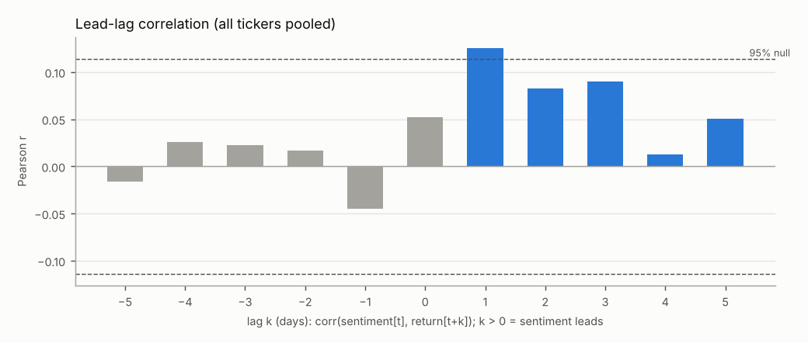
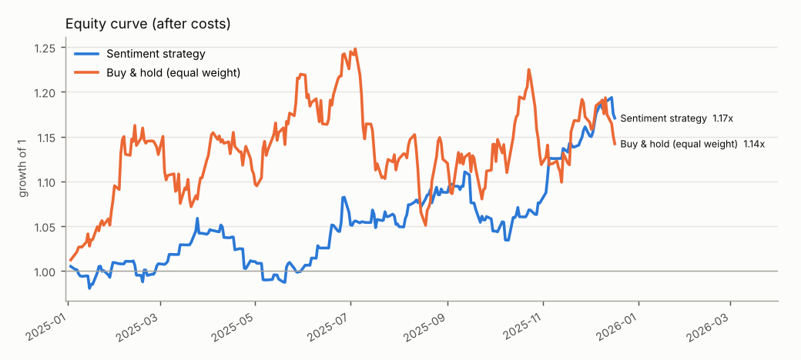
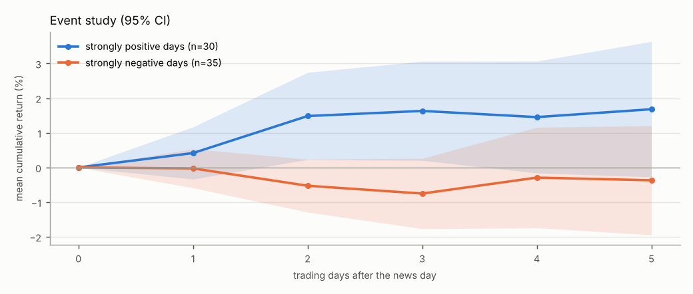
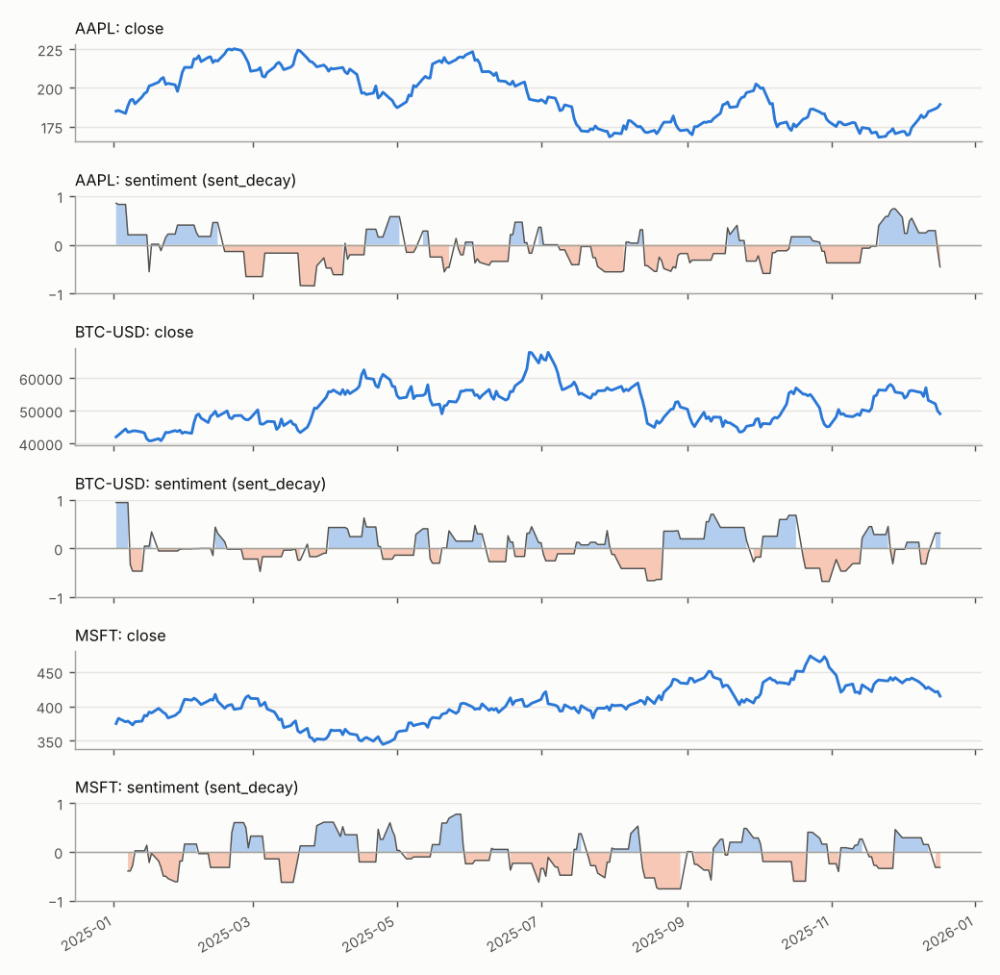

# news-sentiment-trader

[](https://github.com/ariaesm/news-sentiment-trader/actions/workflows/ci.yml)
[](LICENSE)
[](https://www.python.org/)

**Does the news move the price, or does the price move the news?**

`news-sentiment-trader` is a small, honest research pipeline. It scores financial headlines
with an LLM (any OpenAI-compatible API, including a local Ollama model) or with an offline
finance lexicon. It aggregates sentiment per asset per day and measures whether sentiment
*leads* returns. It then backtests a simple sentiment signal with strict
no-look-ahead timing.

It's a research tool, not a trading bot.

## Features

- **Ingestion**: JSON, CSV, RSS 2.0 and Atom (stdlib `xml.etree` + `urllib`), normalized into a
  `NewsItem` dataclass (`id`, UTC `timestamp`, `source`, `title`, `summary`, `tickers`).
  Time-windowed de-duplication.
- **Entity tagging**: YAML keyword → ticker map (`bitcoin`/`BTC` → `BTC-USD`, `Apple` → `AAPL`);
  whole-word matching, case-sensitive symbols, `$CASHTAG` support.
- **Two scorers behind one `SentimentScorer` protocol**
  - `LexiconScorer`: offline, deterministic, hand-written finance lexicon with phrases
    ("beats estimates", "profit warning"), negation windows and intensifiers. Score in [-1, 1].
  - `LLMScorer`: OpenAI-compatible `/chat/completions` over stdlib `urllib`. Batched prompts,
    strict JSON schema `{"score", "label", "reason"}`, defensive parsing, retries with backoff,
    per-headline fallback, and an on-disk cache keyed by `sha256(model + headline)` so that
    reruns are free.
- **Aggregation**: daily mean, count and causal decay-weighted sentiment per ticker, joined with
  daily closes. Headlines go to the first trading close *after* publication.
- **Analysis**: 1- and k-day forward returns, Pearson and Spearman correlation, lead-lag over
  lags −5…+5, an event study with 95% confidence intervals, and a hit rate with a binomial p-value.
- **Backtest**: long above `+threshold`, short (or flat) below `−threshold`, with transaction
  costs. Reports total return, Sharpe, max drawdown and hit rate against equal-weight
  buy-and-hold. Tests check that there is no look-ahead.
- **Report**: `reports/report.md` with tables and matplotlib charts.
- **CLI**: `nst score | analyze | backtest | report | run-all`.
- Dependencies are only numpy, pandas, scipy, matplotlib and PyYAML. 60 tests run offline.

## Pipeline



## Quickstart

```bash
git clone https://github.com/ariaesm/news-sentiment-trader
cd news-sentiment-trader
python -m venv .venv && source .venv/bin/activate
pip install -e ".[dev]"

# Full pipeline on the bundled synthetic data, offline lexicon scorer
nst run-all --news data/sample_news.json --prices data/sample_prices.csv --scorer lexicon

# Or step by step
nst score    --news data/sample_news.json --scorer lexicon --out outputs/scored.csv
nst analyze  --scored outputs/scored.csv --prices data/sample_prices.csv
nst backtest --scored outputs/scored.csv --prices data/sample_prices.csv --threshold 0.2 --cost-bps 5
nst report   --scored outputs/scored.csv --prices data/sample_prices.csv --out reports
```

Run commands from the repository root. The default ticker map is `config/tickers.yaml`, and you
can pass another one with `--tickers`. Useful flags include `--signal sent_mean|sent_decay`,
`--cutoff-hour` (the UTC hour after which news counts for the next session), `--halflife`,
`--long-only` and `--periods-per-year` (use 365 for crypto-only universes). `make help` lists
the developer shortcuts.

**Your own data:**

- **News**: JSON (a list, or `{"items": [...]}`), CSV with `timestamp,title[,source,summary,tickers]`,
  an RSS/Atom file, or an `https://` feed URL.
- **Prices**: CSV in long format (`date,ticker,close`) or wide format (`date,AAPL,MSFT,...`).

## Using an LLM (Ollama, OpenAI, OpenRouter)

The LLM scorer speaks the OpenAI chat-completions protocol, so any compatible server works.
Configure it with environment variables (see `.env.example`) or CLI flags:

```bash
# Local and free: Ollama
ollama pull llama3.1
export NST_LLM_BASE_URL=http://localhost:11434/v1
export NST_LLM_API_KEY=ollama          # any non-empty string
nst run-all --news data/sample_news.json --prices data/sample_prices.csv \
    --scorer llm --model llama3.1 --batch-size 10

# OpenAI
export NST_LLM_BASE_URL=https://api.openai.com/v1
export NST_LLM_API_KEY=sk-...
nst score --news my_news.csv --scorer llm --model gpt-4o-mini

# OpenRouter
export NST_LLM_BASE_URL=https://openrouter.ai/api/v1
export NST_LLM_API_KEY=sk-or-...
nst score --news my_news.csv --scorer llm --model meta-llama/llama-3.1-8b-instruct
```

The scorer sends `response_format: {"type": "json_object"}` and asks for this format:

```json
{"results": [{"id": 0, "score": 0.7, "label": "positive", "reason": "earnings beat"}]}
```

The numeric score is the source of truth. It is clipped to [-1, 1], and a label that disagrees
with the score is recomputed. Results are cached in `.cache/llm/` (one small JSON file per
headline and model), so a rerun makes no API calls. If you change the model, the cache misses
and the headlines are scored again.

## Example output

> ⚠️ **The data in `data/` is synthetic.** `scripts/make_sample_data.py` (seed 42) generates
> random-walk prices for `BTC-USD`, `AAPL` and `MSFT` and template headlines. The headline
> tone is deliberately and weakly linked to the *next* day's return (latent ρ = 0.3 before
> headline noise). The numbers below show that the pipeline can recover a planted effect.
> They say **nothing** about real markets.

These numbers come from running `make docs`, which is `nst run-all --scorer lexicon` on the
synthetic data with the default settings: signal `sent_mean`, threshold ±0.2, 5 bps costs and
long/short positions. The data has 423 headlines and 299 ticker-days with news, from
2025-01-02 to 2025-12-17.

| Metric (pooled, next day) | Value |
|---|---|
| Pearson r (sentiment, next-day return) | 0.125 (p = 0.031, n = 298) |
| Spearman ρ | 0.125 (p = 0.032) |
| Directional hit rate | 56.7% over 238 days (binomial p = 0.022) |

| Backtest | Sentiment strategy | Buy & hold (equal weight) |
|---|---|---|
| Total return | +17.1% | +14.2% |
| Sharpe (ann., rf = 0) | 1.52 | 0.78 |
| Max drawdown | −6.9% | −15.8% |
| Hit rate | 58.8% of active positions | 51.7% (share of up days) |
| Avg. exposure | 31% | 100% |

The pooled lead-lag peaks at **lag +1** (r = 0.125), where the effect was planted. Lags ≤ 0
stay within ±0.06. Only lag +1 clears the approximate 95% band, and with 11 lags tested you
would expect at least one to clear it roughly 40% of the time by chance (1 − 0.95¹¹).






The full generated report has per-ticker tables. Run `make demo` to reproduce it in
`reports/report.md`.

## Methodology & pitfalls

**Timing (look-ahead bias).** This is the main thing to get right:

1. A headline is assigned to the first trading day whose close comes *after* it was published.
   Before `--cutoff-hour` (default 20:00 UTC) it counts for the same day. Later, or on a
   weekend, it counts for the next session.
2. Sentiment on day *D* is therefore fully known at the close of *D*.
3. The position held over the return of day *D+1* is decided from sentiment on *D*. This shift
   happens in one place (`backtest.positions`).
4. Tests check the timing. One test changes future signals and confirms past positions stay
   the same. Another feeds the same-day return in as the "signal" and confirms it gives no
   edge. The decay aggregation has a causality test too.

Forward returns (`fwd_ret_k`) are analysis *targets* only and are never used as features. RSS
items without a parseable date are dropped, not guessed. Real feeds often have a timestamp that
differs from the time the news first became public, for example after edits or late
syndication. In live use that latency is the dominant source of look-ahead.

**Survivorship bias.** If you pick tickers you know today (big winners), the results are biased.
A real study needs a point-in-time universe, including delisted names and dead coins.

**Multiple testing.** The pipeline tests several lags, horizons, thresholds and two signals.
Some of these will look "significant" by chance. Correct for it (Bonferroni, or better, keep
an untouched out-of-sample period) before believing any single p-value. Overlapping k-day
returns are autocorrelated, so their naive p-values are too optimistic. The event-study
thresholds are in-sample quantiles.

**Other caveats.**

- The lexicon is small and generic.
- LLMs may know what happened after a headline (training-data leakage). That makes backtests
  on historical news look better than live trading would. Prefer models with a training cutoff
  before your test period.
- Costs are a flat bps charge with no slippage, borrow fees or market impact.
- Equities and crypto trade on different calendars. The bundled data uses business days for
  simplicity.

## Project layout

```
src/news_sentiment_trader/
  models.py      NewsItem, SentimentResult
  ingest.py      JSON / CSV / RSS / Atom loaders, dedupe
  tagging.py     keyword → ticker tagger
  scorers/       SentimentScorer protocol, LexiconScorer, LLMScorer
  aggregate.py   trading-day assignment, daily + decayed sentiment, price join
  analysis.py    forward returns, correlations, lead-lag, event study, hit rate
  backtest.py    threshold strategy, costs, metrics
  report.py      Markdown + matplotlib report
  cli.py         `nst` entry point
scripts/make_sample_data.py   seeded synthetic data generator
config/tickers.yaml           default keyword map
```

## Development

```bash
make test     # pytest (all offline; the LLM is mocked)
make lint     # ruff check + ruff format --check
make data     # regenerate synthetic data
make docs     # rerun the pipeline and refresh docs/*.png
```

## Roadmap

- [ ] Walk-forward / out-of-sample evaluation and parameter sweeps with multiple-testing correction
- [ ] Abnormal returns (market-model) in the event study
- [ ] Intraday prices and exact publication-time alignment
- [ ] Source weighting and novelty detection (first report vs. rewrites)
- [ ] FinBERT / local transformer scorer as an optional extra
- [ ] Point-in-time ticker universe helpers to reduce survivorship bias

## Disclaimer

**Not financial advice.** This project is for research and education. Nothing in it is a
recommendation to buy or sell anything. Backtests are hypothetical, and the bundled results come
from synthetic data.

## License

[MIT](LICENSE) © 2026 Aria Esmaeilzadeh
